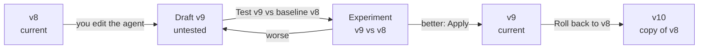

import { Aside } from '@astrojs/starlight/components';
import { GuidedShot, StepCard, StepShot } from '@components/awflow';

**In the app:** sidebar › **Agents & teams** › open an agent › **Evals** tab (under **Observe**).

An agent's settings change over time: new instructions, another model, stricter rules. **Versions** keep each tested setup, so you can see which one scored best and go back to it. A change you haven't tested yet is a **draft**; you test it against the last version with an [experiment](/app/observability/evals/), then keep it or not.

## What a version holds

A version is a snapshot of the settings that shape the agent's answers: **Instructions**, **Role**, **Model**, **Skills**, **Rules**, **Memory** and **Knowledge**. Its name, icon and routines are not part of it.

- **The first version** is saved for you the first time the agent is tested or opened in its **Evals** tab ("first saved version").
- **Editing the agent never creates a version by itself.** Your edits make a draft: the agent now differs from its latest version.
- **Only two things create a version:** **Apply** from an experiment, and **Roll back**.
- **Aria has no versions.** It is built in, so its **Evals** tab only lists the datasets that test it.

## The agent's Evals tab

At the top, the **draft banner** appears when you changed the agent since its latest version.

<GuidedShot
  shot="obs-regression"
  steps={[
    { spot: 'banner', title: 'Draft banner', body: 'What you edited and when, and whether the draft is tested. **Always re-run on change** tests every new draft for you.' },
    { spot: 'test-draft', title: 'Test the draft', body: 'Runs the draft against the latest version on the main dataset and opens the results. Once tested, it becomes **Open results**.' }
  ]}
/>

Below the banner:

- **Versions** lists every version, newest first, with its date, where it came from (*applied from* an experiment, *Copy of v7* after a rollback, *edited*) and its score on the main dataset. The dataset's baseline has a *baseline* chip. An untested draft sits at the top as *v9 · draft*.
- **Datasets** lists the datasets that test this agent, with their size and baseline score. **New dataset** creates one for this agent.
- **Score by version** draws the score of each applied version on the main dataset. Like every chart, it has a table view.

The **main dataset** is the agent's most recently updated dataset that has a baseline, or else its most recently updated dataset.

## Test a draft

When the banner says *draft v9 is not tested yet*:

1. Press **Test v9 vs baseline v8**. AWFlow creates an experiment named *v9 vs v8* on the main dataset: **A** is the latest version as it is, **B** is exactly your draft.
2. The experiment opens and starts. Keep the tab open while it runs.
3. Read the comparison. If B is better, [apply it](#apply-a-winner). If some examples got worse, keep editing and test again.

Once tested, the banner reads *draft v9 · tested* and **Open results** takes you back to the experiment. If the agent has no dataset yet, the banner offers **Create a dataset** instead.

The same check appears at the top of **Observability** › **Evals**: *Inbox Triage changed 4 min ago* with **Run “core” vs baseline**, for the most recently changed agent that has an untested draft. **Later** hides it for that draft.

### Always re-run on change

Tick **Always re-run on change** in the banner to have AWFlow test every draft for you:

- It waits until you've stopped editing the agent for **60 seconds**, then creates and starts the draft-vs-baseline experiment on the main dataset.
- It runs **once per draft**. Edit again and the new draft is tested again after the next quiet minute.
- It needs AWFlow open in a tab, and it skips a main dataset that has no examples.
- The setting is per agent, and is deleted with the agent.

## Apply a winner

Applying saves a variant from an experiment as the agent's next version.

<StepCard n={1} title="Press Apply on the experiment">
  On a finished experiment, **Apply B to agent** proposes the best-scoring variant. The arrow next to it lists the other variants.

  <StepShot shot="obs-compare" spot="apply" n={1} />
</StepCard>

<StepCard n={2} title="Check what changes" check="a message says the agent is now v9, with Open Evals.">
  The dialog *Apply B to Inbox Triage?* lists **What changes**, with the instruction lines added and removed, and the score the version will record. Press **Apply B**.
</StepCard>

Good to know before you apply:

- **Apply is offered** once the experiment is done or cancelled, and only for your own agents.
- **Apply writes the variant over the version the experiment ran on**, not over the agent as it is now. If you edited the agent since and those edits weren't in the experiment, the dialog warns you; tick **Replace my edits** to go on.
- **If the agent got a new version after the experiment started**, Apply is blocked: *The agent changed after this experiment started. Run it again first.*
- Applying also makes that experiment and variant the dataset's baseline, so the next test compares with it.

## Roll back

Each older version in **Versions** has two buttons:

- **Compare with v8** creates and runs an experiment *v7 vs v8* on the main dataset, so you see how the old version does today.
- **Roll back** asks *Roll back to v7?* and then gives the agent the settings of v7 back, **saved as a new version** (for example v10, noted *Copy of v7*). Nothing is deleted: every version stays in the history. If you have untested edits, the dialog says they will be replaced.

## See versions in Monitor

Every conversation records the agent version it ran on. In [Monitor](/app/observability/monitor/), group a chart by **Agent version** to see how a change affected errors, speed or tokens in real use.

## Good to know

- **Versions stay on this device**, next to the agent. They are included when you export your data and deleted with the agent.
- **A version's score is frozen** when it is applied. The baseline score shown for a dataset is live, so ratings you add later in [review](/app/observability/evals/#rate-answers-yourself) can move it.
- **Two tabs, one history.** Apply and Roll back run one at a time per agent, so a tab with an older copy of the agent can't overwrite a newer version.
- **[Fix with Aria](/app/observability/fix-with-aria/)** proposes changes as a draft; you test and apply it the same way.

<Aside title="For developers">
Traces record the version in `awf.agent.version`. In an experiment, only the baseline variant (A, no changes) carries a version, so a variant's runs never count as that version in Monitor.
</Aside>

## Related

- [Evals](/app/observability/evals/): datasets, evaluators, experiments and review.
- [Fix with Aria](/app/observability/fix-with-aria/): turn a weak spot into a draft to test.
- [Monitor](/app/observability/monitor/): group charts by agent version.
- [Agents](/app/chat-and-agents/agents/): edit the agent's instructions, model, skills and rules.
