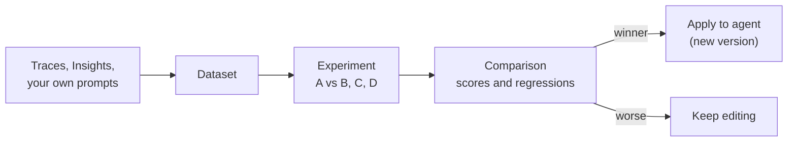

import { Aside } from '@astrojs/starlight/components';
import { GuidedShot } from '@components/awflow';

**In the app:** sidebar › **Observability** › **Evals**. For one agent: open the agent, then its **Evals** tab under **Observe**.

Evals let you check an agent with the same prompts every time, so you know whether a change makes it better or worse before you keep it. You collect test prompts in a **dataset**. You choose how answers are scored with **evaluators**. An **experiment** then runs the agent and up to three variants of it on every prompt and puts the scores side by side.

Applying a winner and going back to an earlier setup are covered in [Agent versions](/app/observability/agent-versions/).

## The Evals page

<GuidedShot
  shot="obs-evals"
  steps={[
    { spot: 'datasets', title: 'Datasets', body: 'Each dataset shows its agent, how many examples it has, where they came from, its last experiment and its baseline score. Click a row to open it.' },
    { spot: 'new-dataset', title: 'New dataset', body: 'Give it a name and pick the agent it tests. **Import** next to it creates a dataset from a CSV or JSON file.' },
    { spot: 'experiments', title: 'Experiments', body: 'Every experiment with its dataset, variants, status and best variant. **New experiment** starts one.' }
  ]}
/>

When you edited an agent and haven't tested the change yet, a banner at the top offers to run it against the baseline. See [Agent versions](/app/observability/agent-versions/#test-a-draft).

## Build a dataset

A dataset is a set of test prompts for one agent. Each prompt is an **example**: one message, as a user would type it, plus what you expect back.

<GuidedShot
  shot="obs-dataset"
  steps={[
    { spot: 'examples', title: 'Examples', body: 'Every test prompt, with its source: **Hand-written**, **From traces**, **AI-generated** or **Imported**. Click one to edit it.' },
    { spot: 'add-from-traces', title: 'From traces', body: 'Pick real conversations to turn into examples.' },
    { spot: 'generate', title: 'Generate with AI', body: 'Let a model suggest new examples. You choose which ones to keep.' },
    { spot: 'evaluators', title: 'Evaluators', body: 'How every answer is scored. They run on every experiment of this dataset.' }
  ]}
/>

The header shows the agent (click it to change it), the number of examples and evaluators, and the baseline. **Export** saves the examples as JSON or CSV. **Dataset actions** › **Delete dataset** removes the dataset with its examples, evaluators, experiments and their runs; the traces stay.

### Ways to add examples

| Button | What it does |
| --- | --- |
| **Add** | Write one example by hand. |
| **From traces** | Lists the last 200 runs of the dataset's agent. Runs marked *Not helpful* or *Failed* are flagged, and runs already in the dataset are greyed out. Tick some and press **Add N examples**: each becomes an example with its input. |
| **Import CSV / JSON** | Opens **Import examples**. Choose the file, then a **New dataset** or an existing one. Nothing is saved until you confirm, and skipped rows are listed with their line numbers. |
| **Generate with AI** | Opens **Generate examples** (see below). |

You can also add examples from elsewhere:

- **A trace:** **Add to dataset** in the trace detail saves that turn as an example, in an existing dataset or a new one. See [Traces](/app/observability/traces/).
- **An experiment:** an expanded row of the comparison has **Add to dataset** too.
- **Insights:** a category page has **Create dataset**, which turns its conversations into a dataset. See [Insights](/app/observability/insights/).

### What an example holds

| Field | What to put in it |
| --- | --- |
| **Input** | The prompt, as the user would type it. Required. |
| **Expected answer** *(optional)* | What a good answer says or does. Only judges see it; the agent never does. |
| **Expected tools** *(optional)* | The tools the agent should call, for example `gmail.search`. Press Enter after each one. |
| **Must contain** *(optional)* | Words or codes the answer must include, for example an invoice number. |
| **Must not contain** *(optional)* | Words the answer must never include, for example "Sent". |
| **Split** *(optional)* | A group name, such as `core` or `edge cases`. |

### Generate examples with AI

1. Press **Generate with AI**. **Based on** tells you what the model reads: the agent's instructions, skills and rules, plus the existing examples so it doesn't repeat them.
2. Pick chips under **Focus on**: **Edge cases**, **Should refuse**, **Ambiguous asks**, **Multi-tool**, **Other languages**.
3. Choose **How many** (5, 10 or 20) and the **Model**: the agent's own, or one on this device.
4. Press **Generate**. Untick the suggestions you don't want. **More** adds another batch without duplicates.
5. Press **Add N examples**. Nothing is saved before this.

The suggestions are written by a model, so read them before you keep them.

## Choose how answers are scored

A new dataset starts with four evaluators: **Completeness**, **Expected tools called**, **Must contain** and **Must not contain**. Press **Add evaluator** to add more. Pick a **Kind**:

| Kind | What it checks |
| --- | --- |
| **Pre-built judge** | A model grades the answer with a ready-made template: **Tool selection**, **Tool invocation**, **Tool response handling**, **Completeness**, **Correctness** (against the expected answer), **Faithfulness**, **Conciseness**, **Refusal**, **User friction**, **PII** and **Toxicity**. |
| **Your rubric** | Write the **Criteria** in plain words, for example *Friendly and short. Signed "Marie — Ops".* The judge scores every answer against it, from 0 to 1. |
| **Code check** | A fixed rule, no model needed: **Must contain**, **Must not contain**, **Exact match**, **Valid JSON**, **Regex**, **JSON schema**, **Expected tools called**, **Latency** (at most N seconds) or **Tokens** (at most N tokens). **Better when the score is** sets whether a pass is good or bad. |

There is a fourth kind, **Human**: your own ratings. You don't add it by hand; AWFlow creates it ("You: helpful") the first time you [review an experiment](#rate-answers-yourself).

Every score runs from 0 to 1. A check that doesn't apply to an example (a **Must contain** on an example with no such words) gives no score, and a judge that fails gives no score either. Neither counts as 0.

## Run an experiment

An experiment runs the agent (**A**, the baseline) and one to three variants (**B**, **C**, **D**) on every example of a dataset, then scores each answer.

<GuidedShot
  shot="obs-new-experiment"
  steps={[
    { spot: 'dataset', title: '1 · Agent and dataset', body: 'Pick the agent and the dataset it runs on. Name the experiment if you like.' },
    { spot: 'variants', title: '2 · Variants', body: 'A is the agent as it is now. In B, C and D, change only what you want to test; everything else stays as the agent has it. **+ Variant** adds one, up to D.' },
    { spot: 'evaluators', title: '3 · Scoring', body: 'Untick evaluators you don\'t need this time. Below them, choose which actions may run for real.' },
    { spot: 'run', title: 'Run', body: 'The button says how many runs it starts. The estimate next to the scoring shows runs, judge calls and tokens first.' }
  ]}
/>

### What a variant can change

By default a variant can change the **Model** (cloud or on this device), **Role**, **Instructions** and **Temperature**. **Vary these too** adds **Skills**, **Rules**, **Memory** and **Knowledge**. Choosing a different **Rules** preset resets its per-action settings, as it does in the agent builder.

### Actions: dry run or for real

Under **Actions in this experiment** you see every tool of the agent:

- **Read-only, runs for real:** tools that only read (search, browse, knowledge search) run normally.
- **Dry run:** every tool that changes something (send, submit, write), and every tool AWFlow can't classify, such as MCP tools and workflow tools, returns a simulated result. Nothing is sent.
- **Run for real:** switch it on for a tool you trust in this experiment. That tool then runs normally.

Browser control is not available in experiments, because a live tab can't be replayed the same way twice. Approvals are answered "deny".

### The other settings

- **Judge model:** one model grades every variant, so they are compared fairly. By default it is the agent's model.
- **Runs per example:** **1**, or **3** to see how much the answers vary.
- **Estimate:** the number of runs and judge calls, the tokens they may use, and how long on-device variants may take. If the estimate goes over the agent's token budget, **Run** asks you to confirm first.

### While it runs

The experiment page opens and shows the progress per variant. It runs in that tab: **Keep this tab open while it runs.** Cloud variants run four prompts at a time; a variant on this device runs one prompt at a time and finishes last.

If the tab closes, the experiment shows **Interrupted**. Press **Resume** to run only what's missing, or **Stop** to end it. **Cancel** stops a running experiment; the runs that finished keep their scores.

## Read the comparison

<GuidedShot
  shot="obs-compare"
  steps={[
    { spot: 'scores', title: 'Scores', body: 'The average per evaluator and variant, from 0 to 1. The best is in bold; ▲ and ▼ compare each variant with the baseline A.' },
    { spot: 'rows', title: 'Examples', body: 'One row per example, with each variant\'s output and scores. A red edge marks a variant that scored worse than the baseline on that example. Click a row for the full outputs, the judge\'s reasons and the traces.' },
    { spot: 'apply', title: 'Apply to agent', body: 'Saves the best variant as a new version of the agent. The arrow lets you pick another variant.' }
  ]}
/>

Below the scores, **Latency P50** and **Tokens per run** compare the variants. Filter the examples with **Worse than baseline**, **Outputs differ** or **Run failed**. In an expanded row you can **Edit expected answer** or **Add to dataset**.

**More actions** › **Pin as baseline** makes this experiment's A the dataset's baseline: the score other experiments and the hub compare with.

**Apply** appears once the experiment is done or cancelled, and only when the agent is one of yours; Aria can't be changed this way. What it does, and how to undo it, is in [Agent versions](/app/observability/agent-versions/#apply-a-winner).

## Rate answers yourself

Scores from a model are a guide. For the answers that matter, press **Review A vs B** on the experiment page and judge them yourself.

<GuidedShot
  shot="obs-review"
  steps={[
    { spot: 'sides', title: 'Two answers, no labels', body: 'Answer 1 and Answer 2 come from two variants. Labels are hidden and the sides are shuffled, so you judge the answer, not the model.' },
    { spot: 'choices', title: 'Pick one', body: 'Choose the better answer, a tie, or skip. A note under **Why?** becomes the explanation on the score.' }
  ]}
/>

| Key | **Which is better?** | **Rate one at a time** |
| --- | --- | --- |
| <kbd>1</kbd> | **Answer 1 is better** | **Good** |
| <kbd>T</kbd> | **Tie** | — |
| <kbd>2</kbd> | **Answer 2 is better** | **Bad** |
| <kbd>S</kbd> | **Skip** | **Skip** |

- **Which is better?** compares two variants. With more than two, a **Pair** menu picks which two.
- **Rate one at a time** shows one answer, label hidden, and you rate it **Good** or **Bad**.
- The keys don't fire while you type in **Why?** or while a dialog is open.
- The review picks up at the first answer you haven't rated. At the end, **Review the skipped ones** brings back what you skipped.
- Your ratings are saved under the human evaluator ("You: helpful") and show in the comparison with the other scores.

## Good to know

- **Experiments stay out of your numbers.** Their runs appear in [Traces](/app/observability/traces/), but never in [Monitor](/app/observability/monitor/) charts or alerts unless a chart asks for them.
- **Tokens still count.** Experiment and judge tokens count toward the agent's [budget](/app/observability/alerts-and-budgets/), but a budget never pauses an experiment.
- **No side effects on your agent.** Experiment runs don't learn memory, don't save a chat and don't write an Activity entry.
- **The baseline is pinned.** An experiment runs on the agent's latest saved version, so editing the agent while it runs doesn't change the remaining runs.
- **Import limits:** CSV or JSON, up to 5 MB and 1,000 examples, inputs up to 8,000 characters. Longer inputs are skipped, never cut. In CSV, the columns are `input`, `expected`, `expected_tools`, `must_contain`, `must_not_contain` and `split`; separate list items with `|`.
- **Regex checks** refuse patterns longer than 300 characters, backreferences and nested repeats, and look at the first 5,000 characters of the answer.
- **A judge reads untrusted text.** The judge prompt fences the input and output and warns the judge when the output tries to steer its grade.
- **Example texts are illustrative.** The names, prompts and scores in the screenshots are sample data.

<Aside title="For developers">
Every experiment run is a normal trace with source `experiment`, the tag `experiment` and the attributes `awf.experiment.id`, `awf.example.id` and `awf.variant`. Simulated tool calls carry `awf.eval.dry_run = true`. Each judge call is an `EVALUATOR` span, so you can open the judge's own prompt and reply in the trace.
</Aside>

## Related

- [Agent versions](/app/observability/agent-versions/): drafts, Apply, roll back and "Always re-run on change".
- [Traces](/app/observability/traces/): find a conversation and add it to a dataset.
- [Insights](/app/observability/insights/): turn a category of conversations into a dataset.
- [Fix with Aria](/app/observability/fix-with-aria/): a proposed fix becomes a draft you test here.
- [Alerts & budgets](/app/observability/alerts-and-budgets/): the token budget experiments count toward.
- [Agents](/app/chat-and-agents/agents/): build and edit the agent you test.
