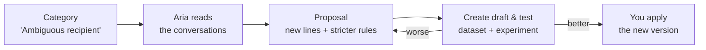

import { Aside, Steps } from '@astrojs/starlight/components';
import { GuidedShot } from '@components/awflow';

**In the app:** an [Insights](/app/observability/insights/) report › a category › **Fix with Aria**. The report's categories table has the same button on each row.

When an Insights report shows a group of conversations that went wrong, for example an agent that keeps emailing the wrong contact, **Fix with Aria** reads those conversations and proposes a change to the agent. It doesn't change the agent. It builds a test instead: a dataset from the conversations and an experiment that compares the agent as it is now with the agent plus the change. You look at the scores, and you decide whether to apply it.

## When it's offered

**Fix with Aria** shows only when all of these are true:

- The report uses the **What people ask**, **Where it gets stuck** or **Custom question** lens. **What it can't do yet** offers [suggestions](/app/observability/insights/#suggestions-for-what-it-cant-do-yet) instead, because a missing ability needs a connection or a skill, not new instructions.
- The report is about **one of your own agents**. A report on **All sources** has no single agent to fix, and built-in agents can't be changed this way.
- The category is a real one, with conversations in it. **Other** never offers it.

## Ask Aria for a fix

<GuidedShot
  shot="obs-category"
  steps={[
    { spot: 'fix-with-aria', title: 'Fix with Aria', body: 'Opens the Fix with Aria panel. Aria starts reading the conversations of this category straight away.' },
    { spot: 'conversations', title: 'The conversations Aria reads', body: 'Aria reads up to 30 of them: the request and the summary of what happened.' }
  ]}
/>

<Steps>

1. Open the report, then the category, and press **Fix with Aria**. On the report, **Fix with Aria** on a row does the same.

2. The panel says *Reading 12 conversations…* while Aria works. It uses the report's model, and the tokens count toward the agent's token budget.

3. The proposal appears. Read it, and edit it if you like (see below).

4. Press **Create draft & test**. AWFlow creates the dataset and the experiment, opens the experiment and starts running it.

5. When the experiment has finished, compare the scores. If the change is better, press **Apply B to agent** on the experiment. That saves it as the agent's next version. See [Agent versions](/app/observability/agent-versions/#apply-a-winner).

</Steps>

*Nothing changes on the agent until you apply the new version from the experiment.* If you close the panel or never apply, the agent stays exactly as it was.

## What the proposal holds

The panel has up to three sections. The text Aria writes is model output: read it before you test it. The examples here are illustrative.

### A short explanation

A line or two from Aria on what it saw in the conversations, for example *The agent sends to the first matching contact when several share a name.*

### 1 · Instructions

New lines **added at the end** of the agent's instructions. The box shows the last two lines of the current instructions in grey (or *No instructions yet*), then the new lines in green, for example:

> \+ When several contacts match a name, ask which one before sending.

The new lines are editable: **One line each. Edit or remove them before testing.** Aria proposes at most 5 lines. It never rewrites or removes what is already in the instructions.

### 2 · New rules

Rules can only make the agent **more careful**. Each proposed rule is a checkbox, with Aria's reason under it:

- **Ask before:** an action the agent does today without asking, for example *Ask before: Submit forms*.
- **Block:** an action the agent may not do at all, for example *Block: Web search*.

Rules apply to the same actions as the agent's **Rules** tab, plus the agent's own workflows and MCP servers. Aria proposes at most 3, and never one that would allow more than the agent has now. Untick a rule to leave it out of the test. When a section is the only one, it is numbered 1.

### How we'll know it worked

The panel says what the test will be, for example:

- *Create dataset "Ambiguous recipient · Inbox Triage" from these 12 conversations, expecting "asks which contact".*
- *Run it on **v8 (now)** vs **v9 (with these changes)**.*

If you remove every line and untick every rule, the panel says *Keep at least one line or one rule to test.* and **Create draft & test** stays disabled.

## What Create draft & test creates

- **A dataset** made from the category's conversations. The model writes the expected answer of each example from Aria's expectation, for example *asks which contact*. The dataset gets the default evaluators.
- **An experiment** on that dataset, named after the category (*… · fix*), with two variants:
  - **A**, *Now · v8*: the agent as it is.
  - **B**, *With fix · v9*: the agent with the new lines and rules.

The experiment opens and starts. If you closed the panel before it was saved, a message *Fix experiment created as a draft* with **Open experiment** takes you there.

Both stay in [Evals](/app/observability/evals/) like any dataset and experiment you made yourself. You can add examples, change evaluators or run the experiment again.

## If the test says no

If B scores worse, or some examples get worse, don't apply it. Back on the category, press **Fix with Aria** again for a new proposal (before you create a test, **Try again** in the panel does the same). You can also edit the agent yourself and test it against the same dataset.

## When there's no proposal

The panel says why:

| Message | What to do |
| --- | --- |
| *…'s token budget is paused, so Aria can't read these conversations now.* | Raise or reset the agent's [token budget](/app/observability/alerts-and-budgets/#token-budgets), then **Try again**. |
| *Aria found no change to propose for these conversations.* | Aria found nothing it could add as a line or a stricter rule. Look at the conversations yourself. |
| *Fix with Aria needs one of your own agents, and this one is no longer available.* | The agent was deleted after the report ran. |
| *Aria couldn't propose a fix. Check the report's model, then try again.* | The model call failed. Check the model's connection, then **Try again**. |

## Good to know

- Fix with Aria never writes the agent. Only **Apply** on the experiment does, and it saves a new version you can [roll back](/app/observability/agent-versions/#roll-back).
- Aria reads at most 30 conversations of the category: their requests and the report's summaries of what happened. They go only to the report's model provider.
- The conversations are treated as untrusted text, so instructions hidden in an email or a web page inside them can't steer the proposal.
- Its model calls are analysis traffic: they count toward the agent's token budget but never appear in Monitor.
- A rule on a kind of action can be overridden by a setting for one item (one workflow, for example). The new rule then doesn't loosen anything, but it may not apply to that item.
- If the agent has an edit you haven't tested yet, the panel shows the live instructions, while variant B builds on the latest saved version.

<Aside type="note" title="For developers">
The proposal is one structured call at temperature 0.2, traced as "Fix with Aria" with source `insights`. Every line and rule is validated: a line is folded to one line, and a blank line, a line over 200 characters, a duplicate or a line already in the instructions is dropped. A rule key must be an action class or a `workflow:` / `mcp:` key of the agent's enabled skills, and its decision must be stricter than what the agent decides today. Invalid items are dropped, never repaired. Create draft & test pins the latest version as the baseline, re-checks the rules against it, creates the dataset and saves the experiment as a draft with B as an instructions and/or rules patch, then starts it.
</Aside>

## Related

- [Insights](/app/observability/insights/): the reports and categories Fix with Aria starts from.
- [Evals](/app/observability/evals/): datasets, experiments and the comparison.
- [Agent versions](/app/observability/agent-versions/): apply a winner, or roll back.
- [Browser control](/app/chat-and-agents/browser-control/#rules): what agent rules allow, ask about or block.
- [Alerts & budgets](/app/observability/alerts-and-budgets/): the token budget Fix with Aria uses.
