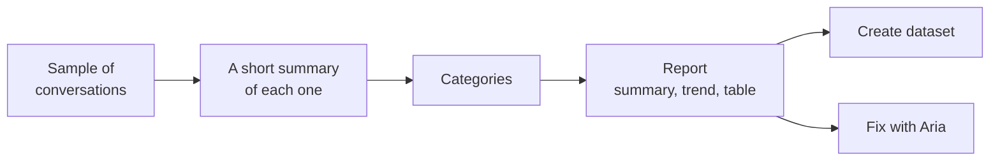

import { Aside } from '@astrojs/starlight/components';
import { GuidedShot } from '@components/awflow';

**In the app:** sidebar › **Observability** › **Insights**. For one agent: open the agent, then its **Insights** tab under **Observe**.

Insights answer questions about many conversations at once. You pick a question, for example *Where does Inbox Triage get stuck?* A model reads a sample of the agent's recent conversations, sorts them into categories and writes a short summary that points to the conversations behind each finding. Run a report once, or let it run every day, week or month so you can follow the trend.

<Aside type="note" title="Not the workflow numbers">
The page that counts your workflow runs, failures and time saved is now called **Workflow stats**. See [Workflow stats](/app/insights/).
</Aside>

## The Insights page

<GuidedShot
  shot="obs-insights"
  steps={[
    { spot: 'lenses', title: 'Start a report', body: 'Pick a lens to open a new report with its question filled in. **Custom question** lets you write your own.' },
    { spot: 'reports', title: 'Reports', body: 'Every report with its **Lens**, **Scope**, **Latest finding**, **Schedule** and **Last run**. Click a row to open it.' }
  ]}
/>

### The lenses

A lens is a ready-made question. It decides which conversations are read and how they are grouped.

| Lens | Which conversations it reads | What you get |
| --- | --- | --- |
| **What people ask** | Every conversation in the period. | The kinds of requests, with their share and trend. |
| **Where it gets stuck** | Only conversations that failed, had a tool call fail, hit a step limit, a loop or a timeout, got a 👎, or waited at an approval for more than an hour. | The causes, grouped. |
| **What it can't do yet** | Every conversation in the period; the model keeps the requests the agent had no skill, connection or permission for. | Missing abilities, each with a suggestion to add it. |
| **Custom question** | Every conversation in the period; the model keeps the ones that answer your question. | The answer to your question. |

Insights never read their own analysis runs, experiment runs or Aria's helper runs, so a report doesn't analyse itself.

## Create a report

Press a lens card or **Custom question**. The **New report** page has four parts.

<GuidedShot
  shot="obs-new-report"
  steps={[
    { spot: 'lens', title: '1 · Lens', body: 'The lens, and the **Question the summary answers**. The question is filled in from the lens and the agent; edit it if you like. A **Custom question** needs one.' },
    { spot: 'sample', title: '2 · Which conversations', body: 'The agent, or **All sources (Aria’s model)** for every source. The period: **Last 7 days**, **Last 14 days** or **Last 30 days**. The **Sample**: 50, 200, 500 or 1000 conversations, picked at random.' },
    { spot: 'categories', title: '3 · Categories', body: '**Let the model find them**, or **Use my categories** to give your own. Below: up to 3 extra things to look for.' },
    { spot: 'schedule', title: '4 · Model and schedule', body: '**Analyse with**: the agent’s own model by default, or another cloud or on-device model. **Schedule**: run it only when you click Run, or daily, weekly or monthly.' },
    { spot: 'estimate', title: 'Estimate and privacy', body: 'How many tokens and minutes the run will take, before you start it.' }
  ]}
/>

Then press **Run now**, or **Save without running** to keep the report for later.

### Which conversations

The defaults are the last 14 days and a sample of 200. Under the sample, a line such as *200 of 612 matching conversations, picked at random.* tells you how many conversations match. When fewer match than the sample size, all of them are read. With **Where it gets stuck**, a chip reminds you that only failed, retried, looped or 👎 conversations count.

A report for **All sources** runs on Aria's model. A report for one agent runs on that agent's model, unless you pick another one under **Analyse with**.

### Categories

- **Let the model find them** (the default): the first run finds the categories. They are then saved on the report, and later runs reuse them, so this week's report compares with last week's.
- **Use my categories**: write the categories yourself, each with a **Name** and **What it is** (which conversations belong there). Add up to 12 with **Add category**. The run sorts conversations into them and doesn't look for its own.

Conversations that fit no category go to **Other**.

### Extra things to look for

Under **Extra things to look for (optional, adds a column per category)**, add up to 3 extra questions the model answers for each conversation. Each has a key, such as `user_frustrated` or `language`, and a type:

- **Yes/no**: the column shows the share of the category's conversations that are a yes.
- **Text**: the column shows the most frequent answer and how often it came up.

A key uses lowercase letters, digits and `_`, starts with a letter and is at most 32 characters long.

### The estimate and the privacy line

Before you run, the box at the bottom shows what the run will take, for example:

> Summaries for 200 conversations + 1 grouping pass ≈ **101k cloud tokens** · about 1 min. On an on-device model this would take ≈ 23 min.

With an on-device model there are no cloud tokens, so the line gives only the time and asks you to keep the tab open. The numbers in the example are illustrative.

Under it, the privacy line: *Conversations stay on this device; only the model provider you chose sees them.*

## Read a report

<GuidedShot
  shot="obs-report"
  steps={[
    { spot: 'summary', title: 'Summary', body: 'The question, a one-line headline and a few bullets. Each **#1**, **#2** opens the conversation the finding comes from.' },
    { spot: 'schedule', title: 'Schedule', body: 'Shows the schedule, or **Schedule** when the report runs only on request. Click it to change the schedule and the notifications.' },
    { spot: 'run-now', title: 'Run now', body: 'Runs the report again on fresh conversations.' },
    { spot: 'categories', title: 'Categories', body: 'Each category with what it is, its share, how many conversations, the error rate, the 👎 rate and the typical (P50) duration. Click the arrow to see its subcategories.' },
    { spot: 'edit-categories', title: 'Edit categories', body: 'Rename, merge, remove or add categories for the next run.' }
  ]}
/>

The line under the title tells you what was read: how many conversations, the period, the model that analysed them and how many tokens it used. Between the summary and the table, a chart shows each category's share per day (for example *Share of stuck conversations per day*).

Each row of the table has:

- **Open**: the category page, with its conversations.
- **Dataset**: turns the category's conversations into an Evals dataset (see [Create a dataset](#create-a-dataset)).
- **Fix with Aria**: when it's offered, proposes a tested change to the agent. See [Fix with Aria](/app/observability/fix-with-aria/).
- On a **What it can't do yet** report, a suggestion button such as **+ Connect Gmail** (see [Suggestions](#suggestions-for-what-it-cant-do-yet)).

**More actions** › **Delete report** deletes the report with all its runs and their categories. The conversations stay in Traces.

### While it runs

A run picks the conversations, summarises them, finds the categories, sorts the conversations into them and writes the summary. The page shows the step and the progress, for example *Summarising conversations · 40 / 200*.

**Keep this tab open while it runs.** If you close it, the run shows **Interrupted**. Press **Resume** to continue where it stopped; it doesn't summarise the same conversations again. You can also **Cancel** a run, and resume it later.

### Earlier runs

When a report has run more than once, the **Earlier runs** menu in the header lets you open an older run. A report keeps its last 12 runs. Each run keeps its own categories, so editing categories never changes a past run.

### Find new categories

The categories are saved after the first run, so later runs stay comparable. When they no longer fit (the agent does new things, for example), press **Find new categories**. This clears the saved categories, and the next run finds new ones. The button is hidden while a run is in progress.

### Edit categories

Press **Edit categories**. A panel opens with the report's categories. *Changes apply from the next run.*

- **Rename** a category or change **What it is**. Trends and links keep working after a rename.
- **Merge into…** another category: the merged category disappears and becomes a subcategory of the one you picked, so the next run still tells them apart. A category holds at most 3 subcategories; when the target is full, the panel says *No room for more subcategories in …*.
- **Remove** a category with its remove button.
- **Add category** to add one. A report holds 1 to 12 categories, and each needs a name.
- Add or change the extra things to look for, up to 3.

Press **Save**. Past runs keep their own categories; the next run uses the new ones.

## A category

**Open** on a row shows the category page.

<GuidedShot
  shot="obs-category"
  steps={[
    { spot: 'create-dataset', title: 'Create dataset', body: 'Turns these conversations into an Evals dataset, up to 50 examples.' },
    { spot: 'fix-with-aria', title: 'Fix with Aria', body: 'Asks Aria for a change that should fix these conversations. Create draft & test then tests it in an experiment. See Fix with Aria.' },
    { spot: 'conversations', title: 'Conversations', body: 'Each conversation with its **Request**, **What happened (model summary)**, **Feedback** and **When**. **Trace** opens the full run.' }
  ]}
/>

The header line tells you how big the category is, for example *12 of 38 stuck conversations (32%)*. Subcategories, when there are any, are listed above the conversations. The list shows 50 conversations at a time; **Show more** loads the next ones.

The summaries in the table are written by a model. Open the **Trace** to see what really happened.

### Create a dataset

**Create dataset (N)** on the category page, or **Dataset** on a report row, opens the **Create dataset** dialog: *Turn these conversations into an Evals dataset.*

1. Check the **Dataset name**.
2. Leave **Ask the model for the expected answer** on to have the report's model write what a good answer is for each conversation. You can edit them in the dataset.
3. Press **Create dataset**. The first 50 conversations become test examples. **Open** in the confirmation goes to the dataset.

What to do with the dataset next is in [Evals](/app/observability/evals/).

## Suggestions for what it can't do yet

On a **What it can't do yet** report, the model also suggests how to add each missing ability. Each suggestion is a button on the category's row that **opens the page where you add it**. Nothing is installed or connected for you.

| Suggestion | Where it takes you |
| --- | --- |
| **Connect** an app (for example **+ Connect Gmail**) | The Connections page, with the form for a new connection open. |
| **Find a "…" workflow** | The marketplace, searching for that kind of workflow. |
| **Add an MCP server** | The agent's **Skills** tab. |
| **Create a routine** | The agent's **Routines** tab. |

**Add an MCP server** and **Create a routine** need an agent, so an **All sources** report never shows them. **Other** and empty categories get no suggestion.

<GuidedShot
  shot="obs-cant-category"
  steps={[
    { spot: 'suggestion', title: 'A suggestion', body: 'Opens the page where you add the missing ability. Nothing is added until you do it there.' }
  ]}
/>

## Schedule a report

Pick a **Schedule** when you create the report, or click the schedule button in the report header later.

| Option | When it runs |
| --- | --- |
| **Only when I click Run** | Never on its own. Shown as **Manual** in the list. |
| **Daily · 08:00** | Every day at 08:00, your local time. |
| **Weekly · Monday 08:00** | Every Monday at 08:00. |
| **Monthly · 1st** | On the 1st of each month at 08:00. |

A scheduled report only runs at times after you set the schedule; it never fills in the past.

### Notify me

With a schedule, **Notify me** has two checkboxes, both on by default:

- **In-app**: the new report shows in the bell and as a message in the app.
- **Desktop**: a notification from your browser. The first time, the browser asks for permission.

The notice gives the report name and its headline, for example *Where it gets stuck · Inbox Triage: …*. A scheduled run that fails says so too.

### When AWFlow was closed

Scheduled reports run in an open AWFlow tab. If no tab was open at 08:00, the report runs the next time you open AWFlow. It catches up only the **latest** missed time: after a week away, a daily report runs once, not seven times.

If you close the tab while a scheduled run is going, it shows **Interrupted** and doesn't start again on its own. Open the report and press **Resume**.

### Waiting for vault unlock

A report that uses a cloud model needs the model's key. If your keys are protected by a [passphrase vault](/app/account/secret-vault/) and the vault is locked when the report is due, the run doesn't fail. It waits:

- the **Schedule** column of the list shows **Waiting for vault unlock**;
- the report page shows *Waiting for vault unlock to run the … report.*, with a **Passphrase** field and **Unlock**;
- you get a notice that the report is waiting.

Once you unlock the vault, here or anywhere in AWFlow, the report runs shortly after.

## The agent's Insights tab

Open an agent, then **Insights** under **Observe**.

<GuidedShot
  shot="obs-agent-insights"
  steps={[
    { spot: 'banner', title: 'Suggested', body: 'The top suggestion from the agent’s latest **What it can’t do yet** report, with how many requests could not be handled. **See requests** opens the category; the action button opens the page where you add it; the cross dismisses it.' },
    { spot: 'lens-cards', title: 'Lens cards', body: 'One card each for **What people ask**, **Where it gets stuck** and **What it can’t do yet** on this agent: the latest finding and its schedule, with **Open**, or **Create** when there is no report yet.' }
  ]}
/>

The banner shows the suggestion of the largest category that has one. **Dismiss suggestion** hides it; a later run can suggest it again. Under the cards, **Your reports** lists the custom questions asked about this agent, and **New custom report** starts one.

## Good to know

- The model can only read what was recorded. If content capture was off, a conversation has no prompts or replies to read; the line under the title counts these (*… without recorded content*). See [Settings & privacy](/app/observability/settings/).
- Conversations stay on this device. Only the model provider you chose for the report reads them.
- Insights runs use tokens, and they count toward the agent's [token budget](/app/observability/alerts-and-budgets/#token-budgets) (Aria's for **All sources**). A budget paused at its limit stops a run before its first model call. Insights runs never appear in Monitor.
- Sometimes the model leaves a few conversations out. They are counted as *not analysed* in the line under the title.
- Every category name, summary and suggestion is written by a model, so it can be wrong. The examples on this page are illustrative.
- The conversations cited in the summary and the first 20 of each category are kept while the report exists. Other conversations follow your retention setting, and their **Trace** button can then lead to a trace that is gone.

<Aside type="note" title="For developers">
A run has five phases: sample, summarise (batched), categorise (one call on up to 300 relevant summaries), assign (batched, with the extra attributes) and summary. Trace content is fenced as untrusted, so text inside a conversation can't steer the analysis. Runs and Create dataset are traced with source `insights`, which Monitor rollups and alerts exclude. A run holds a Web Lock with a heartbeat; after 30 seconds without one it reads as Interrupted. On a schedule, the extension's service-worker alarm only wakes an open app tab, which runs the due slot; the web app uses the page's own timer and catches up on load.
</Aside>

## Related

- [Fix with Aria](/app/observability/fix-with-aria/): turn a category into a tested change.
- [Evals](/app/observability/evals/): use a category's dataset in an experiment.
- [Traces](/app/observability/traces/): every conversation, one by one.
- [Alerts & budgets](/app/observability/alerts-and-budgets/): the bell, notifications and token budgets.
- [Local secret vault](/app/account/secret-vault/): unlock the keys scheduled reports need.
- [Workflow stats](/app/insights/): runs, failures and time saved for workflows.
