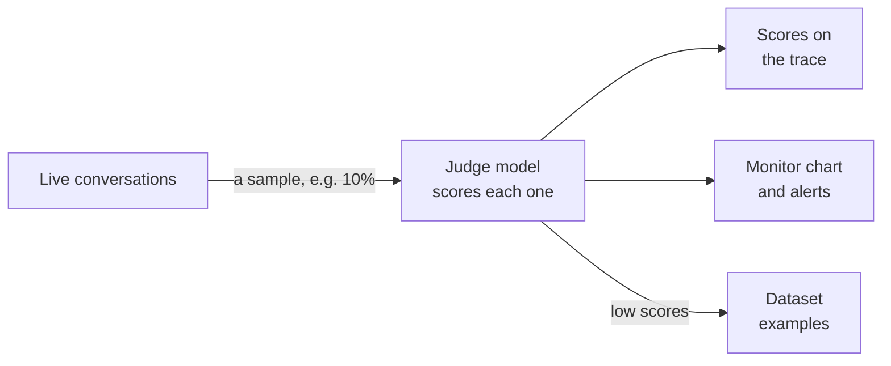

import { Aside } from '@astrojs/starlight/components';
import { GuidedShot, StepCard, StepShot } from '@components/awflow';

**In the app:** sidebar › **Agents & teams** › open an agent › **Evals** tab (under **Observe**) › **Online evals**.

[Experiments](/app/observability/evals/) test an agent on examples you wrote. **Online evals** watch the real thing: a judge model reads a sample of the agent's live conversations and scores each one, for example *Did the answer cover the whole request?* or *Did it pick the right tools?* You see the scores on each conversation, as daily averages in [Monitor](/app/observability/monitor/), and in [alerts](/app/observability/alerts-and-budgets/). The conversations that score low become test examples in one click.

## Set up online evals

Online evals are set per agent, for your own agents. Open the agent's **Evals** tab and click **Set up** on the **Online evals** card. The setup opens on the right (at the bottom on a narrow screen), with **Score live conversations** already on.

<GuidedShot
  shot="obs-online-setup"
  steps={[
    { spot: 'rate', title: 'How many', body: 'The share of conversations to score, from 1% to 100% (10% to start). The line below says about how many that is a day, from the last 14 days.' },
    { spot: 'filter', title: 'Which conversations', body: '**All**, or only some: **Failed**, **With 👎**, **Chat** or **Routines**. Pick several and a conversation is scored when it matches any of them.' },
    { spot: 'evaluators', title: 'Evaluators', body: '**Completeness**, **Tool selection** and **Refusal** are ticked to start. Tick others, or add your own with **+ Add evaluator**.' },
    { spot: 'cap', title: 'Judge model and monthly cap', body: 'The judge is the **Agent’s model** unless you pick another. The cap is the judge tokens online evals may use per month (1,000,000 to start).', check: 'after **Save**, the card shows **On** and *Online evals are on.*' }
  ]}
/>

Under the settings, a grey box estimates the judge tokens a month at this rate and says where the conversations go (see [Privacy](#privacy)). Click **Save**. To change anything later, click **Edit** on the card; turn **Score live conversations** off there to pause scoring without losing the setup.

### Which evaluators you can use

Online evals only offer **reference-free** evaluators: ones that can judge an answer without knowing the right answer in advance. A live conversation has no expected answer to compare with, so **Correctness** (and checks such as **Must contain** or **Expected tools called**) are not offered. The setup says so: *Correctness isn't offered: it needs an expected answer.*

| Kind | Evaluators |
| --- | --- |
| **Judge** | **Completeness**, **Tool selection**, **Tool invocation**, **Tool response handling**, **Faithfulness**, **Conciseness**, **Refusal**, **User friction**, **PII**, **Toxicity** |
| **Your rubric** | A judge with your own instructions, added with **+ Add evaluator** |
| **Code check** | **Valid JSON**, **Regex**, **JSON schema**, **Latency**, **Tokens** |

Some judges skip a conversation they can't apply to: **Tool invocation** and **Tool response handling** need a conversation that used tools, and **Faithfulness** one that looked something up. A skipped evaluator writes no score, rather than a 0. Code checks use no judge tokens.

[Choose how answers are scored](/app/observability/evals/#choose-how-answers-are-scored) explains each evaluator.

### Tokens: the monthly cap and the agent's budget

- **The monthly cap** belongs to online evals. Once the judge has used it, scoring stops until the next month. The card shows how much is used: *Judge tokens · October*, with a meter.
- **The same tokens also count toward the agent's [token budget](/app/observability/alerts-and-budgets/#token-budgets).** When the budget pauses the agent, online evals pause too. When the budget is set to switch to an on-device model, a cloud judge stops, while an on-device judge goes on.
- **Code checks only?** Then nothing is spent, and neither the cap nor the budget stops them.

## What happens next

Scoring starts with the conversations that begin **after you save**. New conversations in the sample are scored within a few minutes, while AWFlow is open in a tab. For older conversations, use [Score past traces](#score-past-traces).

The card then shows what online evals did over the last 7 days:

<GuidedShot
  shot="obs-online-card"
  steps={[
    { spot: 'card', title: 'The numbers', body: 'The sampling rate, how many conversations were scored in 7 days, the judge tokens used this month against the cap, and the **Average score · last 7 days** of each evaluator.' },
    { spot: 'edit', title: 'Edit', body: 'Opens the setup again.' },
    { spot: 'low-link', title: 'Low scores', body: '*2 low scores → Add to dataset* turns those conversations into test examples. **See scored conversations** opens them in Traces.' },
    { spot: 'backfill', title: 'Score past traces…', body: 'Scores conversations from before you turned online evals on.' }
  ]}
/>

On a wide card the numbers sit in three tiles, and each average has a small 7-day trend line. A code check shows its pass rate (*92% pass*) instead of an average. If the judge failed on some conversations, the card says so (*3 judge calls failed in the last 7 days. They are tried again.*).

## Scores on a trace

Open a scored conversation in [Traces](/app/observability/traces/). **Online scores** appears under the summary, with one chip per evaluator: ✓ for a pass, ✕ for a low score.

<StepCard n={1} title="Open a low score" check="the judge's explanation opens under the chips.">
  Click a ✕ chip, here **Completeness 0.35**. The explanation says why the judge scored it low.

  <StepShot shot="obs-online-trace" spot="chips" n={1} zoom={60} />
</StepCard>

<StepCard n={2} title="Act on it">
  **Add to dataset** saves the conversation as a test example. If you disagree with the judge, **Not right? Rate it yourself** jumps to the trace's **Not helpful** (👎) button at the top, so your own rating counts too.

  <StepShot shot="obs-online-trace" spot="explanation" n={2} zoom={60} />
</StepCard>

The line on the right says which model scored it and how many judge tokens it took: *Scored by gpt-5-mini · 4.6k judge tokens*.

**Scores** are 0 to 1, higher is better. A judge's score under **0.5** is a **low score**, and so is a failed code check, which shows *· fail* instead of a number.

## Find and keep the low scores

- **In Traces:** click **Filter**, then under **Online score** pick **Low online score** (or **Scored online** for every scored conversation) and click **Show results**. The filter shows as a chip you can remove. The card's links open the same list for this agent.
- **As test examples:** on the card, click the low-score link (*2 low scores → Add to dataset*). **Add low scores to a dataset** lists the agent's conversations with a low score in the last 7 days, worst first, with their low scores, all selected. Pick the **Dataset**, untick what you don't want, and click **Add 2 examples** (the count follows your selection). If the agent has no dataset yet, the link opens **New dataset** first, then the list.

Then run an [experiment](/app/observability/evals/#run-an-experiment) on that dataset to check that your next change fixes them.

## The scores in Monitor

When the agent has scores, its **Monitor** tab adds an **Online eval scores** chart: the average score per evaluator and day.

<GuidedShot
  shot="obs-online-chart"
  steps={[
    { spot: 'chart', title: 'Online eval scores', body: 'One line per evaluator. A dip shows the day answers got worse. Like every chart, it has a table view.' }
  ]}
/>

In a [custom dashboard](/app/observability/monitor/#custom-dashboards), add a chart with **Data** set to **Online evals**. Its metric is **Eval score (0–1)**, and it groups by **Evaluator**, **Agent** or **Agent version**.

## Get an alert on scores

In **Monitor › Alerts**, click **New alert** and pick **Online eval score** as the metric.

<GuidedShot
  shot="obs-online-alert"
  steps={[
    { spot: 'metric', title: 'Online eval score', body: 'Then pick the agent, the window and the line. It starts at *below 0.7*.' },
    { spot: 'evaluator', title: 'Evaluator', body: '**All evaluators**, or one of the agent’s evaluators. The rule needs at least 5 scores in the window before it can fire.' }
  ]}
/>

The preview shows whether the alert would have fired over the last 48 hours, and the saved rule reads like *Online eval score (Completeness) < 0.70*. Scores are 0 to 1, so a line above 1 isn't accepted. [Alerts & budgets](/app/observability/alerts-and-budgets/) covers the rest.

## Score past traces

Online evals start with new conversations. To score the ones before:

1. On the card, click **Score past traces…**.
2. Pick **How far back**: **7 days**, **14 days** or **30 days**. The estimate reads like *42 conversations · 126 judge calls · ≈ 189k tokens*. It uses the same sample, conversations and evaluators as the setup, and leaves out the ones already scored.
3. Click **Start**. A progress bar on the card counts the conversations; **Stop** ends it early and keeps the scores made so far.

It stops by itself at the monthly cap or when the agent's budget pauses, and says so when it's done. Leaving the Evals tab stops it too.

## Privacy

The judge reads each conversation it scores, the request and the answer, with the tool calls.

- **With a cloud judge** (the agent's model when it's a cloud one, or a model from **Cloud**), each scored conversation is sent to that model's provider, as the agent's own messages are. The setup says *With a cloud model, the conversation is sent to its provider.*
- **With an on-device judge** (from **On this device**), nothing leaves your device: *The judge runs on this device: scored conversations never leave it.*
- The scores stay in this browser, next to the traces. A cloud judge needs your secret vault unlocked; while it's locked, scoring waits.

## Good to know

- **Scores live as long as their trace.** When a trace is removed (by **Keep traces for** in [Settings & privacy](/app/observability/settings/), or by hand), its scores go with it. Scoring a conversation never keeps it longer. Adding it to a dataset does.
- **Sampling is per conversation and stable.** Each conversation is in the sample or not for good: every tab agrees, a conversation is never scored twice, and raising the rate keeps every conversation that was already in.
- **The judges never appear in the scored trace.** Their calls are not added to the conversation they score, and they never count in Monitor's runs or tokens. Their tokens do count toward the cap and the agent's budget.
- **Aria and teams are not covered yet.** Online evals are for your own agents.
- **Deleting an agent** deletes its online evals setup. Its scores go with its traces.

<Aside title="For developers">
Each score is a trace annotation with the id `oe:<traceId>:<evaluatorId>` and `origin: "online"`, stored without pinning the trace. The sample is a stable hash of the trace id. Scores count by their trace's start time, so a later **Score past traces** still lands on the right day.
</Aside>

## Related

- [Evals](/app/observability/evals/): datasets, evaluators and experiments.
- [Traces](/app/observability/traces/): filter on **Low online score**.
- [Monitor](/app/observability/monitor/): the Online evals chart data.
- [Alerts & budgets](/app/observability/alerts-and-budgets/): alerts on scores, and the agent's token budget.
- [Agent versions](/app/observability/agent-versions/): test a fix before you keep it.
