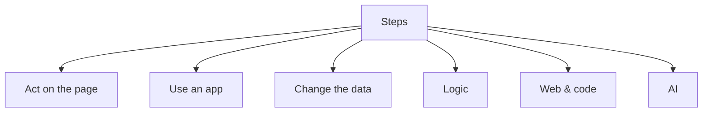

import { Card, CardGrid } from "@astrojs/starlight/components";
import { Kbd } from 'starlight-kbd/components';

A workflow is a chain of **steps**. Each step does one thing: read the page, call an app, change the data, decide where to go next, ask an AI model. (The [node reference](/nodes/) uses the technical word *node* for the same thing.)

A **trigger** is the step that decides when the workflow starts. Every other step runs after it, following the links between steps.

## Kinds of steps

The step picker groups steps by what they do: **Act on the page**, **Use an app**, **Change the data**, **Logic**, **Web & code**, **AI** and **Your reusable workflows**. Browse them all in the [node reference](/nodes/).

### Where a step runs

Some steps show a small marker in the picker and on the canvas:

- **Cloud**: the step sends your data to the AWFlow service to do its work. It needs an account and an internet connection.
- **External API**: the step calls an app's API (Slack, Notion…) straight from your browser. It needs an account with that app and an internet connection.
- **Extension**: the step runs in the AWFlow browser extension (page steps, polling triggers). It doesn't work in the web app.
- **No marker**: the step runs entirely in your browser.

## Add a step

- **After a step**: click the **+** on its right. The picker asks **What happens next?** and suggests likely next steps. The new step is linked for you and comes into view.
- **Drop a wire**: drag from a step's output (or an AI step's model, tool or memory slot) and let go on an empty spot. The picker opens for that output, and the new step lands where you let go.
- **On a link**: hover a link between two steps and click **+** to insert a step there. Steps after it move right to make room.
- **From the keyboard**: select a step and press <Kbd mac="N" windows="N" />. See [Keyboard shortcuts](/app/workflows/keyboard-shortcuts/).
- **On an empty canvas**: **Add trigger** asks **What should start this workflow?**, or **Describe it to Aria**, or **Start from a template**.

If you add an action to a workflow with no trigger, a **When I press Run** trigger is added and linked for you (one **Undo** removes both).

Search the picker by name or by what you want ("send email", "split"): results show as one list, ranked by how often people use each step. With fewer than three results, **Can't find it?** offers to **Ask Aria to build it**, **Use HTTP Request** for any API, or **Request it** on the [request board](/app/request-board/).

New steps get plain names ("HTTP Request", then "HTTP Request 2", or "Gmail: Send message"). Rename a step by clicking its title in its settings, or with <Kbd mac="F2" windows="F2" />.

## Set up a step

Double-click a step (or select it and press <Kbd mac="Enter" windows="Enter" />) to open its settings.

The header shows the step's icon, its name, one line on what it does, **How it works** (more detail) and **Add a note** (a note for whoever reads the workflow later).

- **Setup** holds the fields. The connection comes first, then the required fields, then the main ones; the rest sit under **More options (N)**, which opens by itself when one of them is set or has a problem.
- **Advanced** holds what happens on errors, retries and empty results (see below). A dot on the tab means something differs from the default.

On a wide screen, **Input**, **Setup** and **Output** sit side by side in three columns you can resize. In the side panel, an **Input · Setup · Output** switch shows one at a time.

### Fields

Every field has the same parts: the label (with **Optional** when it is), a help line, the control, and one status line (an error, the preview of an expression, or **Default: …** when the field is empty and a default will be used).

The **⋯** menu next to a label offers **Edit as expression** / **Use a fixed value**, **Copy expression**, **Reset to default** and **Ask Aria about this field**. To put data from an earlier step in a field, see [Mapping data](/concepts/data/data-mapping/data-mapping-ui/).

In name/value cards (Edit Fields, HTTP headers, query and body), a card left on the default type follows what you type: `42` becomes a number, `[…]` a list, `{…}` an object, `true` a yes/no. A chip shows the type (**abc**, **123**, **✓**, **{ }**, **[ ]**); choose another one from the card's **⋯** menu.

At the top of **Setup**, an issue bar lists what is still missing ("2 things left: Channel, Message"). Tap a chip to jump to that field.

### Connections inside the step

A step that uses an app has a **Connection** field. It lists only that app's connections, with **Connected as …** from the last test. With no connection yet, **Connect Slack** opens the form in a sheet over the step: when you save it, it is picked, tested and ready. See [Connections](/app/connections/).

### Building blocks of AI steps

AI steps (Tools Agent and friends) list their **Building blocks** at the top of **Setup**: the model (required), memory, knowledge, an output parser and their tools. **+ Add a model** or **+ Add a tool** opens the picker for that slot; **Open** jumps into the block's own settings. **Change** opens the picker for that slot: the block you pick takes the old one's place in one undo step (the old one is removed, or only unlinked when another step still uses it); closing the picker changes nothing. A model or tool step can't be run alone: run the agent that uses it.

## Ready to run

Before a run, **Ready to run** (on the canvas) lists what still needs you: connections to make, fields to fill, [variables](/app/variables/) to set, models to add. Steps that need setup carry a badge on the canvas.

- Hover or focus a row to ring its steps on the canvas.
- **Connect** a group ("Connect Google Sheets · used in 3 steps") once: the account you pick goes to every step of the group that has none yet.
- **Fill**, **Connect** and **Add** open the step on the right field.

The **Workflow doctor** block below lists deeper problems: a loop without an exit, a branch that goes nowhere, a secret typed into a field, a step that doesn't work in the web app. Warnings can be ignored per workflow.

## Run a step

**Run step** (in the settings header) runs the steps it needs and then this one, and opens its **Output**. If the step isn't linked to anything before it, or a required field is empty, it doesn't start and tells you why, with **Add a step before** or **Fix**.

After a run:

- If you were typing in a field, only the **Last run** bar shows ("Last run: 12 items · 0.4 s · View output"), so you aren't interrupted.
- When a run fails on a field, the bar offers **Fix**, which jumps to it.
- **Settings changed since this result · Run again** shows when you edit after a run.

Chips at the top of **Input** (the steps before) and under **Output** (the steps after) open those steps in place.

## Read the output

**Output** shows the step's items as a **Table** (search, pages of 50, drag the column edges), **Raw (JSON)** or **Structure**; in the side panel, items show as cards. Before any run, **Expected** shows the fields the step promises, so you can map them in the next step.

- When a step ran several times in one run (in a loop), a **Run 3 of 12** stepper picks the run to show. The **Input** follows it (*Input follows run 3 too*, with **Unlink**), showing what the earlier steps passed in that pass. Expressions always use the latest run.
- **Hints** above the output explain something worth knowing ("Ran 12 times: every combination of 3 from A and 4 from B", "Limit of 100 items reached"). **Don't show again** hides one hint for that step.

## Step status on the canvas

Each step shows one status badge, the most important first: **Needs setup**, **Failed**, a data warning (amber: the run reported expression warnings), **Disabled**, then **Ran**. Hover or focus it to see every state and what fixes it. A step inside a loop shows how many times it ran (**×12**). A step whose newer version is available shows **Update available** (see [Step versions](/app/workflows/step-versions/)).

## When a step fails

Under **Advanced**, **On error** chooses what happens when the step fails (after any retries):

- **Stop the run** (default).
- **Continue with an empty result**: the error is logged and the step passes one empty item on.
- **Send to an error output**: each failed item goes down a red **Error** output, with `{ error: { message, name }, input, itemIndex }`, while the other items carry on. See [Error handling](/concepts/flow/error-handling/#send-failed-items-to-an-error-output).

**Try again automatically** retries a failed step: **Retries** (how many more tries), **Wait (seconds)**, **Wait pattern** (**Same each time** or **Longer each time**) and **Which errors** (**Any error**, **Temporary only**, or **When the message matches**). Steps that call the network and were added by Aria or a template retry twice by default.

**Pass an empty item when there's no result** makes the step hand on one empty item when it finds nothing, so the next steps still run.

A failed step stops **its own branch**. Branches that don't depend on it keep running. A step joining several branches needs all of them; [Join branches](/nodes/builtin/flow/funnel/) runs as soon as any branch that didn't fail reaches it. The run is reported as **Failed**, with the first failed step as its cause.

## Disable a step

Select a step and press <Kbd mac="D" windows="D" /> (or the power button in its toolbar, or its menu) to **disable** it without deleting it. A disabled step is greyed and struck through, with dashed links:

- in a run it does nothing and passes its input straight on (a router passes everything to its first output, a loop leaves by Done);
- a disabled trigger doesn't start the workflow.

Turning a workflow On, or publishing it, warns you when it has disabled steps.

## Copy, paste, tidy

- **Copy steps** / **Paste steps** (<Kbd mac="Cmd+C" windows="Ctrl+C" /> / <Kbd mac="Cmd+V" windows="Ctrl+V" />) work across workflows and windows. Connections and secrets are removed from the copy, and references to renamed steps are fixed.
- **Duplicate** (<Kbd mac="Cmd+D" windows="Ctrl+D" />) copies in place.
- **Tidy up** lays the canvas (or the selection) out left to right, one lane per branch, AI blocks under their agent. One **Undo** restores your layout.
- On a wide canvas, steps show as larger tiles with a subtitle (the operation, "Every day at 09:00"). **Compact steps** in the controls' **More** menu keeps them small.

## What's next?

<CardGrid>
  <Card title="Mapping data" icon="seti:json">
    Use data from earlier steps in a field. [Go →](/concepts/data/data-mapping/data-mapping-ui/)
  </Card>
  <Card title="Runs" icon="list-format">
    See what happened in a past run. [Go →](/app/workflows/run-history/)
  </Card>
  <Card title="Node reference" icon="puzzle">
    Every step, its settings and outputs. [Go →](/nodes/)
  </Card>
</CardGrid>
