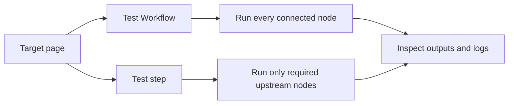

import { StepCard, StepShot } from "@components/awflow";

When you’re building a workflow, you usually want to test it as you go.

AWFlow gives you two ways to do that:

- **Run the whole workflow** (end-to-end)
- **Run one step** (and only what’s needed before it)

---

## Run the whole workflow (full run)

Use this when you want to see the complete result from start to finish.

<StepCard n={1} title="Click Test Workflow">
  Open the page you want the workflow to work on, then, on the canvas, click **Test Workflow**. The workflow runs step by step, and the button turns into **Running… 2 of 4 | Stop** so you can see how far it got.

  <StepShot shot="last-run" spot="test-workflow" n={1} />
</StepCard>

<StepCard n={2} title="Read the Last run tab" check="it says It worked, or explains what went wrong.">
  When the run ends, the **Last run** tab of the panel on the right says what happened in plain words. **Run again** starts it once more.

  <StepShot shot="last-run" spot="last-run" n={2} zoom={44} />
</StepCard>

<StepCard n={3} title="Check each step">
  Each step that ran has a green check, and each connection shows how many items passed along it. Double-click a step to see its input and output.

  <StepShot shot="last-run" spot="step-output" n={3} />
</StepCard>

### One run at a time

While a run is in progress, every other way to start one — **Test Workflow**, a node's play button, **Test step**, **Run again**, **Run once to test** — is disabled, with a tooltip saying why. Two runs at once would mix their outputs and logs.

You can keep editing during a run. Your changes don't affect the run in progress, and they stay marked as unsaved until you save.

### Stop a run

Click **Stop** on the running button. The step that is already running finishes; nothing after it starts. The run is recorded as canceled, and the **Last run** tab shows how many steps ran before it stopped.

### When a run fails

The **Last run** tab explains the failure in plain words instead of showing the raw error:

- **What happened**, e.g. *"Get weather couldn't reach the service."*
- **Why it probably happened** — a network problem or a site that blocks requests from the browser, a refused key (401 / 403), a rate limit (429, with a countdown when the service says how long to wait), a used-up quota, a missing connection or a field that needs attention.
- **Try this** — a few concrete things to do, and a button to open the step's settings, reconnect it or run again.
- **Show technical details** — the step, time, run id, the error the step reported and its input, with **Copy details** for a bug report.

You get a single notification for a failed run, and only when the panel isn't on screen (for example when the run was started from the workflow list or the tab was in the background). Testing a single step still shows a short notification when it fails.

---

## Run one step (partial run)

Use this when you’re adjusting one node and want fast feedback.

When you run a step, AWFlow will also run any steps *before it* that are required to provide input.

<StepCard n={1} title="Open the step's settings">
  Double-click the step you want to test.

  <StepShot shot="canvas" spot="step" n={1} />
</StepCard>

<StepCard n={2} title="Click Test step" check="the Output side of the panel shows what the step returned.">
  <StepShot shot="node-settings" spot="test-step" n={2} />
</StepCard>

You can also right-click a step and choose **Test Step**.

If you don’t want parts of the workflow to run while testing, temporarily disable those nodes.

---

## Manual and automatic runs

- A **manual run** is one you start yourself: from the canvas, the [workflow list](/app/workflows/executions/run-from-the-workflow-list/) or the [right-click menu](/app/workflows/executions/run-from-the-right-click-menu/).
- An **automatic run** starts from a trigger, such as a schedule or a page load. The workflow must be **Active**. See [Automatic runs with triggers](/app/workflows/create/#automatic-runs-with-triggers).
- A run that reaches a [Wait For Approval](/nodes/builtin/flow/wait-for-approval/) node pauses until someone approves, rejects or cancels it in the **Executions** panel.

## Related

- [Workflow lifecycle](/concepts/flow/workflow-lifecycle/)
- [Execution order](/concepts/flow/execution-order/)
- [Troubleshooting guide](/app/troubleshooting/)
- [Wait For Approval](/nodes/builtin/flow/wait-for-approval/)
