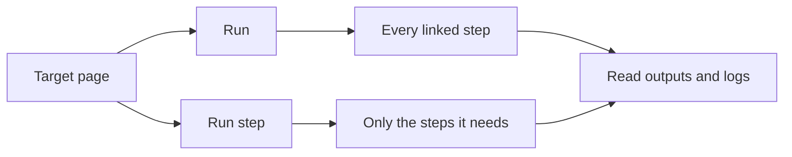

import { StepCard, StepShot } from "@components/awflow";
import { Kbd } from 'starlight-kbd/components';

While you build a workflow, run it as you go. There are two ways:

- **Run** the whole workflow, from its trigger to the end.
- **Run step**: one step, and only the steps it needs before it.

Every run is recorded in [Runs](/app/workflows/run-history/), even when you haven't saved your changes yet: the run then shows **Ran unsaved changes** and keeps a copy of what ran.

---

## Run the whole workflow

<StepCard n={1} title="Press Run">
  Open the page you want the workflow to work on, then press **Run** (the play button) on the canvas, or <Kbd mac="Cmd+Enter" windows="Ctrl+Enter" />. The button turns into **Running… 2 of 4 | Stop** so you can see how far it got.

  <StepShot shot="last-run" spot="test-workflow" n={1} />
</StepCard>

<StepCard n={2} title="Read the Last run tab" check="it says It worked, or explains what went wrong.">
  When the run ends, the **Last run** tab of the panel on the right says what happened in plain words. **Run again** starts it once more.

  <StepShot shot="last-run" spot="last-run" n={2} zoom={44} />
</StepCard>

<StepCard n={3} title="Check each step">
  Each step that ran has a green check, and each link shows how many items passed along it. Double-click a step to see its input and output.

  <StepShot shot="last-run" spot="step-output" n={3} />
</StepCard>

A workflow with a [form trigger](/nodes/builtin/trigger/form-trigger/) opens its form when you press **Run**. A [polling trigger](/concepts/flow/polling-triggers/) fetches a test event (the latest items) instead of waiting for new ones.

### One run at a time

While a run is in progress, every other way to start one (**Run**, a step's play button, **Run step**, **Run again**) is disabled, with a tooltip saying why. You can keep editing during a run: your changes don't affect it.

### Stop a run

Press **Stop**. The step that is already running finishes (code and AI steps stop at once); nothing after it starts. The run is recorded as **Canceled**.

### When a run fails

The **Last run** tab explains the failure in plain words instead of the raw error:

- **What happened**, for example *"Get weather couldn't reach the service."*
- **Why it probably happened**: a network problem or a site that blocks requests from the browser, a refused key (401 / 403), a rate limit (429, with a countdown when the service says how long to wait), a used-up quota, a missing connection, or a field that needs attention.
- **Try this**: concrete things to do, with a button to open the step's settings (on the right field), reconnect it, run again, or **Fix with Aria**.
- **Details**: the step, time, run id, the error the step reported and its input, with **Copy details** for a bug report (it warns you before copying, as details can contain data).

Under the explanation, **Did this explain the problem?** asks for a thumbs up or down, to improve these messages.

You get one notification for a failed run, only when the panel isn't on screen. While a step's settings are open, its failure shows in its **Output** instead of a notification.

---

## Run one step

When you run a step, AWFlow also runs the steps before it that it needs for its input.

<StepCard n={1} title="Open the step's settings">
  Double-click the step.

  <StepShot shot="canvas" spot="step" n={1} />
</StepCard>

<StepCard n={2} title="Press Run step" check="the Output of the step shows what it returned.">
  The button is in the header of the step's settings.
</StepCard>

You can also right-click a step and choose **Run step**. If the step isn't linked to anything before it, or a required field is empty, it doesn't start and says why. To keep part of the workflow from running while you test, [disable those steps](/app/workflows/components/nodes/#disable-a-step).

To retry a step with the data of an earlier run, open that run in **Runs** and use **Debug in editor**: see [Debug a run in the editor](/app/workflows/run-history/#debug-a-run-in-the-editor).

---

## Manual and automatic runs

- A **manual** run is one you start yourself: from the canvas, the [workflow list](/app/workflows/executions/run-from-the-workflow-list/) or the [right-click menu](/app/workflows/executions/run-from-the-right-click-menu/).
- An **automatic** run starts from a trigger, such as a schedule or a page load. The workflow must be **On**. A workflow whose only trigger is **When I press Run** shows **Runs when you press Run** instead of the On/Off switch.
- A run that reaches a [Wait For Approval](/nodes/builtin/flow/wait-for-approval/) step pauses until someone approves, rejects or cancels it in **Runs**.

## Related

- [Runs](/app/workflows/run-history/)
- [Keyboard shortcuts](/app/workflows/keyboard-shortcuts/)
- [Workflow lifecycle](/concepts/flow/workflow-lifecycle/)
- [Execution order](/concepts/flow/execution-order/)
- [Troubleshooting](/app/troubleshooting/)
