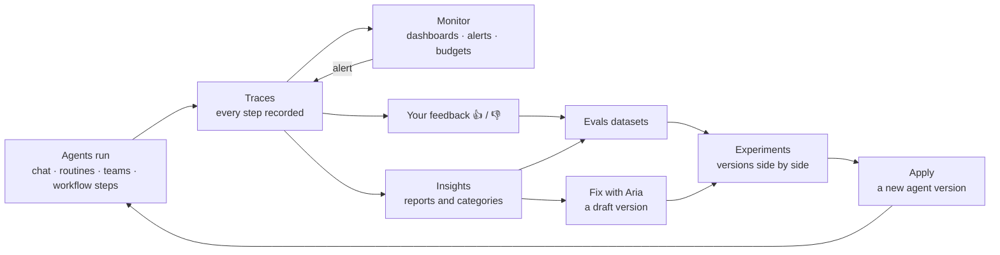

import { Aside, CardGrid, LinkCard } from "@astrojs/starlight/components";

:::note[In 20 seconds]
Every time Aria, an agent, a team, a routine or an AI workflow step answers, AWFlow writes down what happened, step by step: which model it asked, which tools it used, what it looked up, how long each step took and how many tokens it used. One answer is a **trace**, each step in it is a **span**, and a whole conversation is a **thread**. You read traces in **Observability**. **Monitor** follows them over time, **Evals** test a change before you keep it, and **Insights** sum up what people ask. Everything stays on your device unless you send a copy to a tool of your own.
:::

## Traces, spans and threads

Say you ask an agent called *Inbox Triage* to draft a reply to a supplier. Behind the answer it prepares its context, recalls a few memories, searches your mail, writes the draft and checks a rule before it saves it. AWFlow records each of these steps.

| Word | What it is | In the example |
| --- | --- | --- |
| **Trace** | Everything that happened for one request: usually one turn of a conversation, from your message to the reply. | "Draft a reply to the supplier" and the answer. |
| **Span** | One step inside a trace: a model call, a tool call, a lookup, a rule check. Spans can contain other spans. | *Used gmail.search*, *Thinking*, *Checked rule "Emails need my approval"*. |
| **Thread** | All the traces of one conversation (or one team thread, or one workflow run). | The whole chat with Inbox Triage. |
| **Source** | Who ran it: an agent, Aria, a team, a routine or a workflow step. | Agent. |

A trace is a small tree. The first span is the agent's turn; under it are its steps, and under each step the model and tool calls that made it:

```text
Inbox Triage
├─ Prepare context
│  ├─ Prepared context
│  └─ Recalled memories
├─ Step 1 · search Gmail
│  ├─ Thinking
│  └─ Used gmail.search
├─ Step 2 · write the draft
│  ├─ Thinking
│  └─ Used gmail.create_draft
│     └─ Checked rule "Emails need my approval"
└─ Final answer
   └─ Thinking
```

The names in this tree are illustrative. Your agents, steps and tools carry their own names.

### Kinds of span

Each span has a **kind**. AWFlow shows a plain label for it; Developer view shows the kind's technical name.

| Kind | What it records | Shown as |
| --- | --- | --- |
| `AGENT` | One turn of an agent, a teammate, Aria or an AI Agent workflow step. | The agent's name |
| `CHAIN` | A step of the turn, such as preparing the context, one round of tool calls or the final answer. | The step's name, for example *Step 2 · write the draft* |
| `LLM` | One call to a model, in the cloud or on your device. | *Thinking* |
| `TOOL` | One tool or skill call, including MCP tools and teammates. | *Used* and the tool's name |
| `RETRIEVER` | A memory recall or a knowledge base search. | *Recalled memories* or *Looked up knowledge* |
| `EMBEDDING` | Turning the question into numbers so it can be searched. | *Indexed the question* |
| `RERANKER` | Putting knowledge results in order. | *Ranked results* |
| `GUARDRAIL` | A rule's decision: allow, ask, block or hand over. | *Checked rule* and the rule's name |
| `PROMPT` | Putting together what the model receives: instructions, skills, memory and history. | *Prepared context* |
| `EVALUATOR` | A score given during an experiment. | *Scored:* and the evaluator's name |

A few patterns are worth knowing:

- **Auto model switches.** When a model fails and Auto model tries another one, both attempts sit side by side under one step. The failed one is marked as an error.
- **Tools run in parallel.** Calls made at the same time sit under one step, so the timeline shows them side by side.
- **Approvals and long waits.** When an action waits for your approval, the trace is **Waiting**. When you answer, even days later, the rest of the work is added to the same trace.
- **Teams.** A teammate's turn is its own trace, linked to the hand-off that started it.
- **Workflow steps.** An AI step in a workflow has its own trace, linked to the workflow run.

## The four pillars

Traces are the raw record. Three more views are built from them:

| Pillar | The question it answers |
| --- | --- |
| **Traces** | What exactly happened in this run? |
| **Monitor** | How is it doing over time? Is an agent close to its token budget? |
| **Evals** | Is version B of my agent better than version A? Did my change break something? |
| **Insights** | What do people ask, where does the agent get stuck, and what can't it do yet? |

They feed each other:



- A 👎 on a reply can add that turn to a **dataset**, a set of test examples.
- An **experiment** runs the dataset against two or more versions of an agent and scores them.
- When a version wins, **Apply** makes it the agent's new version, and new traces show whether it holds up.
- **Monitor** watches the traces for you and alerts you when something drifts.

## Two depths, one record

Each screen can be read two ways:

- **The summary.** This is the default, written for anyone. It gives a one-line story such as *Inbox Triage answered in 6.5 s using 14.1k tokens*, plain step names such as *Thinking* or *Used gmail.search*, and a fix button when something failed, for example **Reconnect Gmail**. That example story is illustrative.
- **Developer view.** One switch away, on the same trace. It shows raw span names and kinds, model ids, trace and session ids, the full input and output as JSON, and every attribute.

Both read the same data, so there is nothing to turn on before you need the detail.

<Aside type="note" title="For developers">
AWFlow follows the OpenTelemetry data model: W3C trace and span ids, status, events, links and resource attributes. Each span carries **OpenInference** attributes (`openinference.span.kind`, `llm.*`, `tool.*`, `retrieval.*`), which Arize Phoenix reads, and **OpenTelemetry GenAI** attributes (`gen_ai.*`) side by side, plus AWFlow's own `awf.*` attributes. Token counts are recorded; `llm.cost.*` is never set. You can export traces as OTLP JSON or send them to an OTLP collector. See [Send to your tools](/app/observability/collectors/).
</Aside>

## Privacy in one paragraph

Traces, datasets, experiments and reports live in your browser. Prompts and replies are kept by default, because Evals and Insights need them, but API keys, tokens and passwords are removed before anything is saved. You can stop recording, keep timings and token counts only for chosen agents, or turn off content altogether. Nothing goes to the AWFlow servers. A copy leaves your device only if you add a collector of your own. See [Settings & privacy](/app/observability/settings/).

## Learn the screens

<CardGrid>
  <LinkCard title="Observability overview" href="/app/observability/overview/" description="Where to find it and what each tab is for." />
  <LinkCard title="Traces" href="/app/observability/traces/" description="Read a run step by step, rate replies and fix failures." />
  <LinkCard title="Monitor" href="/app/observability/monitor/" description="Dashboards, alerts and token budgets." />
  <LinkCard title="Evals" href="/app/observability/evals/" description="Datasets and experiments to compare agent versions." />
  <LinkCard title="Insights" href="/app/observability/insights/" description="What people ask and where agents get stuck." />
  <LinkCard title="Send to your tools" href="/app/observability/collectors/" description="Copy spans to Phoenix, Langfuse or any OTLP collector." />
</CardGrid>

## Good to know

- Only AI work is traced. Workflow steps that don't use AI keep their usual [run history](/app/workflows/run-history/).
- Tokens are counted; AWFlow never works out a price.
- Experiments and Insights reports run their own traces. They never count in Monitor.
- A trace that a dataset, your feedback or an Insights report uses is kept even when older traces are cleaned up.

## Related

- [Observability overview](/app/observability/overview/): where everything is in the app.
- [Traces](/app/observability/traces/): reading a run.
- [Settings & privacy](/app/observability/settings/): recording, content and storage.
- [Testing AI workflows](/concepts/ai/evaluation-testing/): checking answers before you rely on them.
- [Agents and tools](/concepts/ai/ai-agents/): how an agent picks its tools.
