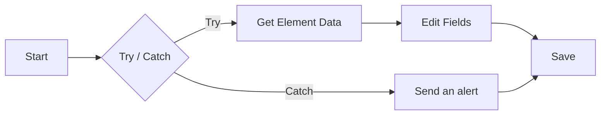

import { CardGrid, LinkCard } from "@astrojs/starlight/components";
import { CompareCards, GuidedShot, ItemsPlayground } from "@components/awflow";

:::note[In 20 seconds]
By default, a failing step ends the run. You can change that per step in its **Advanced** tab: **Try again automatically** retries, **On error** can **Continue with an empty result** or **Send to an error output** (failed items go down a red Error output while the others carry on). For a group of steps, **Try / Catch** sends a failure down a separate branch. An **Error Trigger** starts another workflow when a run fails.
:::

## See it happen

Try / Catch guards a page read. The page has changed and the step fails, so the rest of the guarded steps are skipped and the **Catch** branch receives one item describing the failure.

<ItemsPlayground
  hydrate="visible"
  steps={[
    { name: "Try / Catch", kind: "flow", note: "Try branch", items: { url: "https://shop.example/p/1" } },
    { name: "Get Element Data", kind: "data", note: "failed", count: "error" },
    {
      name: "Catch branch",
      kind: "flow",
      items: {
        nodeLabel: "Get Element Data",
        message: "No element matches the selector .price",
        input: { url: "https://shop.example/p/1" },
      },
    },
  ]}
  caption="Illustration of a run. The Catch item names the failed step, its error and the data it was given."
/>

## Pick how to handle a failure

<CompareCards
  label="Ways to handle a failure"
  cards={[
    {
      title: "Retry",
      icon: "retry",
      when: "The failure is often temporary: a timeout, a busy server, a rate limit.",
      example: "2 more tries, longer each time, temporary errors only.",
      meta: "step Advanced tab",
    },
    {
      title: "Continue with an empty result",
      icon: "skip",
      when: "The step is optional and the rest of the run should go on.",
      example: "A thumbnail that's nice to have.",
      meta: "step Advanced tab · On error",
    },
    {
      title: "Send to an error output",
      icon: "shield",
      when: "Some items fail and you want to handle them apart while the others carry on.",
      example: "Log the rows a CRM refused, keep the rest.",
      meta: "step Advanced tab · On error",
    },
    {
      title: "Try / Catch",
      icon: "shield",
      href: "/nodes/builtin/flow/try/",
      when: "A group of steps needs a plan B when any of them fails.",
      example: "If the page can't be read, post an alert and stop.",
      meta: "Try · Catch",
    },
    {
      title: "Error Trigger",
      icon: "alert",
      href: "/nodes/builtin/trigger/errortrigger/",
      when: "You want to hear about failed runs, whatever failed.",
      example: "Message yourself when the nightly sync fails.",
      meta: "starts a workflow",
    },
  ]}
/>

## Retry a flaky step

Double-click the step to open its settings, then:

<GuidedShot
  shot="node-settings-retry"
  steps={[
    { spot: 'advanced-tab', title: 'Open the Advanced tab', body: 'A dot on the tab means something differs from the default.' },
    { spot: 'try-again', title: 'Turn on Try again automatically', body: 'The retry options appear under it.' },
    { spot: 'retries', title: 'Retries', body: 'How many more tries after the first one, between 2 and 10. The step runs at most 1 + this many times.' },
    { spot: 'wait', title: 'Wait (seconds)', body: 'The pause before each new try.' },
    { spot: 'wait-pattern', title: 'Wait pattern', body: '*Same each time*, or *Longer each time*, which suits rate-limited services.' },
    { spot: 'which-errors', title: 'Which errors', body: '*Any error*, *Temporary only* (429, 5xx, network errors and timeouts; fails at once on errors like 401 or 404), or *When the message matches* a text or `/regex/`.' },
    { spot: 'time-limit', title: 'Time limit', body: 'Off by default. Turn it on to stop the step when it takes longer than the time you set.' },
  ]}
/>

When a service answers 429 or 503 with a **Retry-After**, AWFlow waits at least that long (up to 5 minutes). The run log says each time: "Retry 1 of 2 (attempt 2 of 3)". Steps that call the network and were added by Aria or a template retry twice by default.

## Carry on after a failure

**On error**, in the same **Advanced** tab, decides what happens once the retries are used up:

<GuidedShot
  shot="node-settings-retry"
  steps={[
    { spot: 'on-error', title: 'On error', body: '*Stop the run* (default), *Continue with an empty result* (the error is logged and the step passes one empty item on), or *Send to an error output* (see below).' },
    { spot: 'empty-item', title: "Pass an empty item when there's no result", body: "The step hands on one empty item when it would otherwise output nothing, so the run doesn't end at this step." },
  ]}
/>

## Send failed items to an error output

With **On error** set to **Send to an error output**, the step gets a red **Error** output after its other outputs. When the step works on several items and some fail:

- each **failed item** goes down **Error**, as `{ error: { message, name }, input, itemIndex }`;
- the items that worked carry on through the normal output.

The normal output runs only if at least one item worked, and the Error output only if one failed; an unused side is skipped like an untaken If branch. The run is recorded as **Done with errors**, and the canvas shows an amber "2 failed → Error" badge on the step; its **Output** switches between **Success** and **Error**.

Some failures still stop the step: you pressed Stop, or you refused a permission. An Error output with nothing linked to it fails the step as before.

## Catch a failure with Try / Catch

Wire the steps you want to protect to the **Try** output of a [Try / Catch](/nodes/builtin/flow/try/) node, and the plan B to **Catch**. Bring both branches back into the same step to mark where the guarded part ends.

If a guarded step fails, the rest of the Try branch is skipped and Catch runs with `nodeLabel`, `message` and `input`. A failure inside the Catch branch isn't caught by the same Try: it goes to an outer Try / Catch, or ends the run.

To stop a run on purpose with a clear message, use [Stop and Error](/nodes/builtin/flow/stopanderror/).

## Hear about failed runs

An [Error Trigger](/nodes/builtin/trigger/errortrigger/) starts a workflow when a watched workflow fails. It receives the failed workflow, the step that failed, the error and its input. It fires for runs that start on their own (a schedule, a page load, a hotkey and so on), not for runs you start yourself from the editor, and not for failures a Try / Catch already handled. A failed run is always recorded as **Failed** (never **Canceled**), so the Error Trigger sees it.

[Workflow settings](/app/workflows/settings/#when-this-fails) › **When this fails** lists the workflows that watch this one and can **Create an error workflow** for you.

## You'll notice this when…

One failing step ended the whole run

That's the default. Turn on **Try again automatically** or change **On error** in the step's **Advanced** tab, or guard it with [Try / Catch](/nodes/builtin/flow/try/).

A step kept retrying a "401 Unauthorized" error

**Which errors** is set to *Any error*. Set it to *Temporary only* so the step fails fast when the problem won't go away, then fix the connection.

The steps after a failed step get an empty item

That's how **Continue with an empty result** works: the failed step outputs one empty item. Add a fallback in later expressions, such as `{{ $input.title || "Untitled" }}`, or check for it with an [If](/nodes/builtin/flow/if/), or use **Send to an error output** instead.

The Error Trigger didn't fire

You started the run yourself, a Try / Catch handled the failure, or the alert workflow isn't **On**. See the [Error Trigger rules](/nodes/builtin/trigger/errortrigger/).

A page step fails with an element not found

The page changed, or it wasn't ready yet. Add [Wait For Element](/nodes/extension/ui/wait-for-element/) before the step, and check the selector still matches. See [Browser context](/concepts/flow/browser-context/).

## Next

<CardGrid>
  <LinkCard title="Next concept: Lambda workflows" description="Reuse a group of steps in many workflows." href="/concepts/flow/lambdaworkflows/" />
  <LinkCard title="Practise it" description="Recipes that guard page reads and API calls." href="/recipes/" />
</CardGrid>
