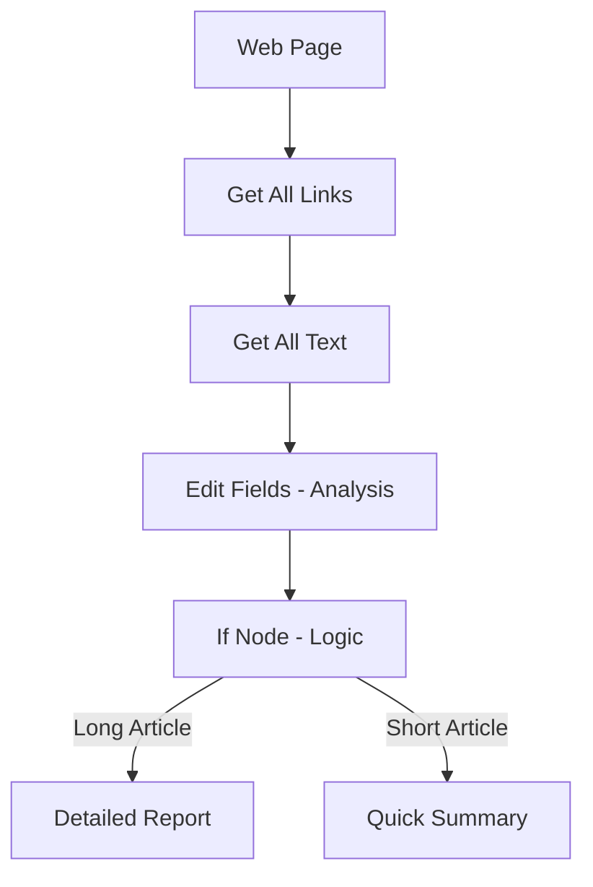
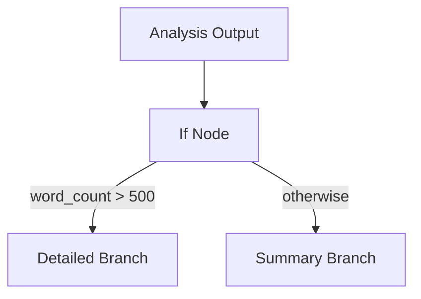

import { Card, CardGrid } from "@astrojs/starlight/components";
import { StepShot } from "@components/awflow";

Ce pas-à-pas prolonge [Votre premier workflow](/get-started/first-workflow/) et fait partie du [niveau 2 · Travailler avec les données](/get-started/working-with-data/). C'est un pas-à-pas de référence, pas encore une vraie leçon : il n'a ni suivi de progression ni vérifications.

Vous allez créer une automatisation qui :

- extrait des liens et du texte d'une page web ;
- traite et analyse le contenu extrait ;
- utilise une règle simple (une étape **If**) pour choisir la suite ;
- produit un résultat différent selon le contenu de la page.

Comme avant, tout s'exécute entièrement dans votre navigateur — aucun serveur n'est nécessaire.

---

## Vue d'ensemble du workflow



- D'abord, extraire les liens de la page
- Ensuite, extraire le texte complet de la page
- Analyser le texte avec des expressions personnalisées
- Utiliser un nœud If pour brancher vers un chemin « long » ou « court »
- Mettre en forme le rapport final en conséquence

Voilà l'idée principale des workflows : ils peuvent réagir à ce qu'ils trouvent sur la page.

---

## Étape 1 : démarrer un nouveau workflow

1. Cliquez sur l'icône de l'extension AWFlow. L'application s'ouvre dans le [panneau latéral](/app/side-panel/).
2. Ouvrez **Workflows**, cliquez sur **Ajouter un flux de travail**, choisissez **Blank canvas** puis **Triggered**, donnez-lui un nom et cliquez sur **Créer et ouvrir**.
3. Vous devriez maintenant avoir un canevas vide avec un bouton **Ajouter un déclencheur**.

<StepShot shot="create-workflow" spot="blank-canvas" n={1} />

---

## Étape 2 : ajouter un nœud d'extraction de liens

1. Cliquez sur **Ajouter un déclencheur**, saisissez `when` dans le champ de recherche du panneau **Déclencheur** et choisissez **Au démarrage**. Cliquez ensuite sur le **+** à son bord droit.
2. Cherchez **Get All Links** et insérez-le.
3. Par défaut, il extrait les URL et les libellés de tous les liens `<a>` de la page actuelle.
4. Cliquez sur **Étape de test** pour le tester.

Vous verrez la liste des liens dans la sortie du nœud.

Voilà comment récupérer tous les liens hypertexte de la page.

<StepShot shot="gs-trigger-search" spot="when-started" n={2} />

---

## Étape 3 : ajouter l'extraction et le traitement du texte

1. Depuis **Get All Links**, cliquez sur le **+** à son bord droit.
2. Cherchez **Obtenir tout le texte** et ajoutez-le.
3. Cliquez sur **Étape de test** pour récupérer le texte complet de la page.
4. Depuis **Obtenir tout le texte**, cliquez de nouveau sur le **+** à son bord droit.
5. Insérez **Modifier les champs** pour analyser le texte.
6. Double-cliquez dessus, puis cliquez sur **Ajouter un champ** une fois par champ.
7. Configurez ces champs en copiant les valeurs ci-dessous :
   - **word_count**: `{{ $json.text.split(' ').length }}`
   - **character_count**: `{{ $json.text.length }}`
   - **summary**: `{{ $json.text.substring(0, 200) }}...`

8. Cliquez sur **Étape de test** pour voir les résultats de l'analyse.

Vous obtenez ainsi un « profil » rapide de la page : sa longueur, plus un court aperçu.

<StepShot shot="gs-edit-fields" spot="add-field" n={3} alt="Ajouter un champ dans le panneau de paramètres d'un nœud Modifier les champs (ici avec le champ processed_text de la leçon 2)." />

---

## Étape 4 : ajouter une logique de branchement avec le nœud If



1. Depuis le nœud Modifier les champs, cliquez sur le **+** à son bord droit.
2. Cherchez `IF` et insérez **IF**.
3. Configurez-le :
   - **Entrée** : `word_count` (sélectionnez-le dans la sortie du nœud précédent)
   - **Operator** : « Number > Larger »
   - **Valeur** : `500`

4. Testez le nœud If. Vous verrez deux chemins possibles : « true » (plus de 500 mots) et « false » (moins).

Votre workflow peut maintenant prendre des chemins différents selon la longueur du contenu.

<StepShot shot="gs-if-search" spot="if" n={4} />

---

## Étape 5 : créer des sorties propres à chaque branche

Pour la branche **longue (true)** :

1. Cliquez sur le connecteur **true** du nœud If.
2. Ajoutez un nœud **Modifier les champs**.
3. Définissez les champs :
   - `report_type` : « Detailed Analysis »
   - `message` :

     ```
     Long article: {{ $json.word_count }} words, {{ $json.character_count }} chars
     Preview: {{ $json.summary }}
     ```

Pour la branche **courte (false)** :

1. Cliquez sur le connecteur **false**.
2. Ajoutez **Modifier les champs**.
3. Définissez les champs :
   - `report_type` : « Quick Summary »
   - `message` :

     ```
     Short article: {{ $json.word_count }} words
     Preview: {{ $json.summary }}
     ```

Exécutez ensuite le workflow complet. La sortie finale différera selon que le contenu est « long » ou « court ».

---

## Étape 6 : exécuter et passer en revue le workflow complet

1. Rendez-vous sur une page web contenant beaucoup de texte (par exemple un article d'actualité).
2. Dans l'éditeur, cliquez sur **Tester le workflow** (il s'exécute à partir du déclencheur).
3. Regardez le workflow s'exécuter étape par étape :
   - les liens sont extraits ;
   - le texte complet est récupéré ;
   - le texte est analysé ;
   - la logique de branchement s'applique ;
   - les nœuds du rapport final produisent leur sortie.

4. Inspectez la sortie du dernier nœud pour voir le message généré.

Vous avez maintenant une automatisation à branchements, qui tient compte du contenu, créée entièrement dans le navigateur.

---

## À essayer ensuite

- Ajouter un **nœud d'IA / LLM** pour résumer la page ou détecter le sentiment
- Extraire des images ou des métadonnées (voir [Nœuds du navigateur](/nodes/extension/))
- Utiliser les nœuds **Wait / Click / Scroll** pour naviguer et extraire plusieurs pages
- Partager votre workflow sur la **Place de marché** et étudier les modèles de la communauté

---

## Et ensuite ?

<CardGrid>
  <Card
    title="Workflows propulsés par l'IA"
    icon="seti:pipeline"
  >
    Apprenez à intégrer des dépendances de modèle pour une analyse plus poussée du contenu.

    [Y aller  →](/concepts/ai/)

  </Card>

<Card
title="Nœuds du navigateur"
icon="puzzle"
href="/nodes/extension/"

>

Découvrez tous les nœuds de manipulation du navigateur pris en charge.

    [Y aller  →](/nodes/extension/)

  </Card>

<Card
title="Concepts"
icon="open-book"

>

Passez en revue les bases des déclencheurs, des nœuds et du flux de données.

    [Y aller  →](/concepts/)

  </Card>

<Card
title="Dépannage et bonnes pratiques"
icon="seti:yml"

>

Des conseils pour déboguer, optimiser et rendre les workflows plus robustes.

    [Y aller  →](/app/troubleshooting/)

  </Card>
</CardGrid>
