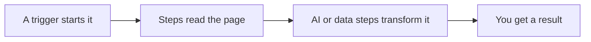

import { LinkCard, CardGrid } from "@astrojs/starlight/components";
import { Badge } from "@components/awflow";

Agentic Workflow (AWFlow) automatise ce que vous faites sur les sites web : lire une page, copier des données, remplir des formulaires, résumer avec l'IA. Vous créez un **workflow** en reliant des étapes sur un canevas, ou vous demandez à l'assistant, **Aria**, de le construire pour vous. Il s'exécute dans votre navigateur, donc il travaille sur la page que vous consultez, et il ne demande aucun compte.

## Commencez ici : niveau 1 · Vos premières automatisations

Cinq leçons, environ 30 minutes au total. Chacune se termine par quelque chose qui fonctionne, et votre progression est enregistrée dans ce navigateur. <Badge variant="no-setup" />

<CardGrid>
  <LinkCard title="1 · Installer AWFlow" description="Ajoutez l'extension, épinglez-la, ouvrez le panneau latéral. 3 min." href="/get-started/install/" />
  <LinkCard title="2 · Votre premier workflow" description="Lisez le texte sélectionné sur une page et remettez-le en forme. 6 min." href="/get-started/first-workflow/" />
  <LinkCard title="3 · Résumer une page avec l'IA" description="Ajoutez un modèle, sur l'appareil ou avec une clé d'API, et obtenez trois points clés. 8 min." href="/get-started/summarize-with-ai/" />
  <LinkCard title="4 · Votre première automatisation" description="Lancez-la avec un raccourci clavier ou selon un planning, puis consultez ses exécutions. 5 min." href="/get-started/first-automation/" />
  <LinkCard title="5 · Demander à Aria d'en créer un" description="Décrivez un workflow dans le chat et ouvrez le résultat sur le canevas. 5 min." href="/get-started/build-with-aria/" />
</CardGrid>

Découvrez tout le parcours, y compris la suite après le niveau 1, dans le [parcours d'apprentissage](/get-started/learning-path/).

## Comment fonctionne un workflow

1. **Un déclencheur le démarre** : vous cliquez sur Exécuter, une page se charge, vous appuyez sur un raccourci, un planning se déclenche, ou vous faites un clic droit.
2. **Des étapes (nœuds) font le travail** : lire du texte, des liens ou des tableaux sur la page, cliquer et remplir, transformer des données, interroger un modèle d'IA.
3. **Vous voyez la sortie de chaque étape**, ce qui vous permet d'ajuster une étape et de relancer jusqu'à obtenir le bon résultat.

## Déjà à l'aise ?

<CardGrid>
  <LinkCard title="Recettes" description="Des workflows complets pour une tâche précise, prêts à importer." href="/recipes/" />
  <LinkCard title="Utiliser l'application" description="Chaque écran de l'application : workflows, exécutions, connexions, Aria, paramètres." href="/app/" />
  <LinkCard title="Concepts" description="Comment fonctionnent les données, le flux et l'IA, plus en profondeur." href="/concepts/" />
  <LinkCard title="Référence des nœuds" description="Chaque nœud, ses paramètres et ses sorties." href="/nodes/" />
</CardGrid>
